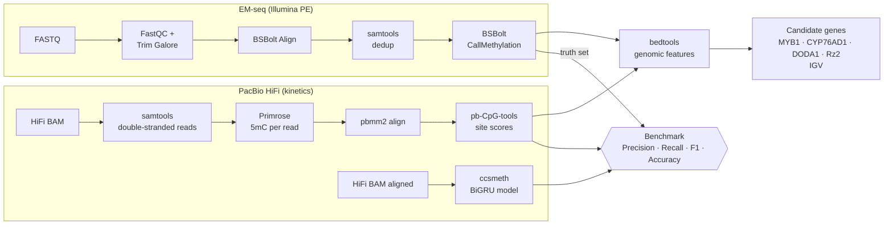

<div align="center">

# 🧬 DNA Methylation Analysis in Table Beet

**Genome-wide 5-methylcytosine profiling of *Beta vulgaris* (table beet) with PacBio HiFi and enzymatic methyl-seq (EM-seq)**

[](https://doi.org/10.1038/s41598-026-77397-6)
[](https://doi.org/10.1038/s41598-026-77397-6)
[](LICENSE)


</div>

---

## 📖 Overview

DNA methylation is an epigenetic mark that can change gene expression without changing the DNA sequence. In plants it occurs in three sequence contexts: **CG**, **CHG** and **CHH** (H = A, C or T). This repository holds the analysis scripts used to:

1. **Call 5mC** from PacBio HiFi reads with two independent tools, **Primrose + pb-CpG-tools** and **ccsmeth**.
2. **Benchmark** both HiFi callers against an **EM-seq truth set** (BSBolt, ~99× coverage) using precision, recall, F1 score and accuracy.
3. **Map methylation onto genomic features**: genes, exons, introns, CDS, UTRs, TSS/TTS and repeats on the nine pseudo-chromosomes.
4. **Inspect breeding-relevant genes**, namely the betalain-pathway genes ***BvMYB1***, ***CYP76AD1*** and ***DODA1*** and the rhizomania-resistance gene ***Rz2***.

> This work was part of a Dual Master's degree in the **Erasmus Mundus Joint Master in Plant Breeding (emPLANT+)**. The data were provided by the **Institute of Computational Biology (ICB), BOKU University, Vienna**. The results are part of the publication below.

## 📄 Publication

> Holzweber T., Dorn K. M., **Rasaki L. A.**, Dohm J. C., Himmelbauer H. (2026). Genome and methylome of the root crop table beet (*Beta vulgaris*). ***Scientific Reports***. https://doi.org/10.1038/s41598-026-77397-6
>
> Open access (CC BY 4.0) · published 27 October 2026 · preprint: [bioRxiv 10.64898/2026.09.07.749830](https://doi.org/10.64898/2026.09.07.749830)

The article presents **RefTab-1**, a chromosome-scale assembly of the inbred table beet line W357B (668.6 Mbp, N50 72 Mbp, 96 % anchored to nine pseudo-chromosomes). It also reports high cytosine methylation in repeats and context-specific methylation in gene bodies and promoters.

## 🔬 Workflow



## 📁 Repository structure

```text
.
├── scripts/
│   ├── 01_pacbio_primrose_pbcpg.sh               # HiFi 5mCpG: Primrose → pbmm2 → pb-CpG-tools
│   ├── 02_pacbio_ccsmeth.sh                      # HiFi 5mCpG: ccsmeth deep-learning caller
│   ├── 03_emseq_bsbolt.sh                        # EM-seq: trimming → BSBolt → dedup → calling
│   └── 04_genomic_features_and_candidate_genes.sh # Feature overlap + BLAST of target genes
├── docs/
│   └── caller_evaluation.md                      # Benchmark design and metric definitions
├── CITATION.cff
├── LICENSE
└── README.md
```

## 🛠️ Software

| Tool | Version | Purpose |
|---|---|---|
| [samtools](https://www.htslib.org/) | 1.x | BAM filtering, sorting, deduplication |
| [Primrose](https://github.com/PacificBiosciences/primrose) | 1.3.0 | 5mCpG prediction from HiFi kinetics |
| [pbmm2](https://github.com/PacificBiosciences/pbmm2) | 1.12.0 | HiFi read alignment |
| [pb-CpG-tools](https://github.com/PacificBiosciences/pb-CpG-tools) | 2.3.1 | Site-level CpG scores |
| [ccsmeth](https://github.com/PengNi/ccsmeth) | 0.x | Deep-learning 5mCpG caller |
| [Trim Galore](https://github.com/FelixKrueger/TrimGalore) / FastQC | – | EM-seq read QC and trimming |
| [BSBolt](https://github.com/NuttyLogic/BSBolt) | 1.x | EM-seq alignment and methylation calling |
| [bedtools](https://bedtools.readthedocs.io/) | 2.x | Overlap with genomic features |
| [gffread](https://github.com/gpertea/gffread) / BLAST+ | – | Candidate-gene extraction and annotation |
| [IGV](https://igv.org/) | – | Visual inspection of methylation tracks |
| R | ≥ 4.0 | Figures |

## 🚀 Usage

The scripts record the analysis as it was run on the ICB BOKU servers. Before running them, edit the path and thread variables at the top of each script.

```bash
git clone https://github.com/olaraym/DNA_Methylation-Analyis-in-Table-beet.git
cd DNA_Methylation-Analyis-in-Table-beet

bash scripts/01_pacbio_primrose_pbcpg.sh
bash scripts/02_pacbio_ccsmeth.sh
bash scripts/03_emseq_bsbolt.sh
bash scripts/04_genomic_features_and_candidate_genes.sh
```

The raw reads are not stored in this repository. See the publication's *Data availability* section for the accession numbers.

## 🌱 Why it matters for breeding

| Gene | UniProt | Trait link |
|---|---|---|
| *BvMYB1* | M1ETK3 | Transcription factor that activates betalain (red pigment) synthesis |
| *CYP76AD1* | I3PFJ5 | Cytochrome P450 in the betacyanin branch |
| *DODA1* | I3PFJ9 | DOPA 4,5-dioxygenase that forms betalamic acid |
| *Rz2* | – | Resistance to rhizomania (*Beet necrotic yellow vein virus*) |

Methylation at these loci shows whether epigenetic variation could add to the pigment and disease-resistance differences that breeders select for. This is useful when designing markers or interpreting differences in expression between lines.

## 📚 Citation

Click **"Cite this repository"** in the sidebar, or cite the article:

```bibtex
@article{holzweber2026tablebeet,
  title   = {Genome and methylome of the root crop table beet (Beta vulgaris)},
  author  = {Holzweber, Thomas and Dorn, Kevin M. and Rasaki, Laide A. and Dohm, Juliane C. and Himmelbauer, Heinz},
  journal = {Scientific Reports},
  year    = {2026},
  doi     = {10.1038/s41598-026-77397-6}
}
```

## 🙏 Acknowledgements

- **Institute of Computational Biology, BOKU University, Vienna**: sequencing data and computing resources
- **Erasmus Mundus emPLANT+**: scholarship and programme support
- Colleagues at ICB for the in-house gene and repeat annotations and the *Rz2* sequence

## 👤 Author

**Laide Abbas Rasaki** · [](https://orcid.org/0000-0002-5594-6827) · [GitHub @olaraym](https://github.com/olaraym)

<sub>Released under the [MIT License](LICENSE).</sub>
